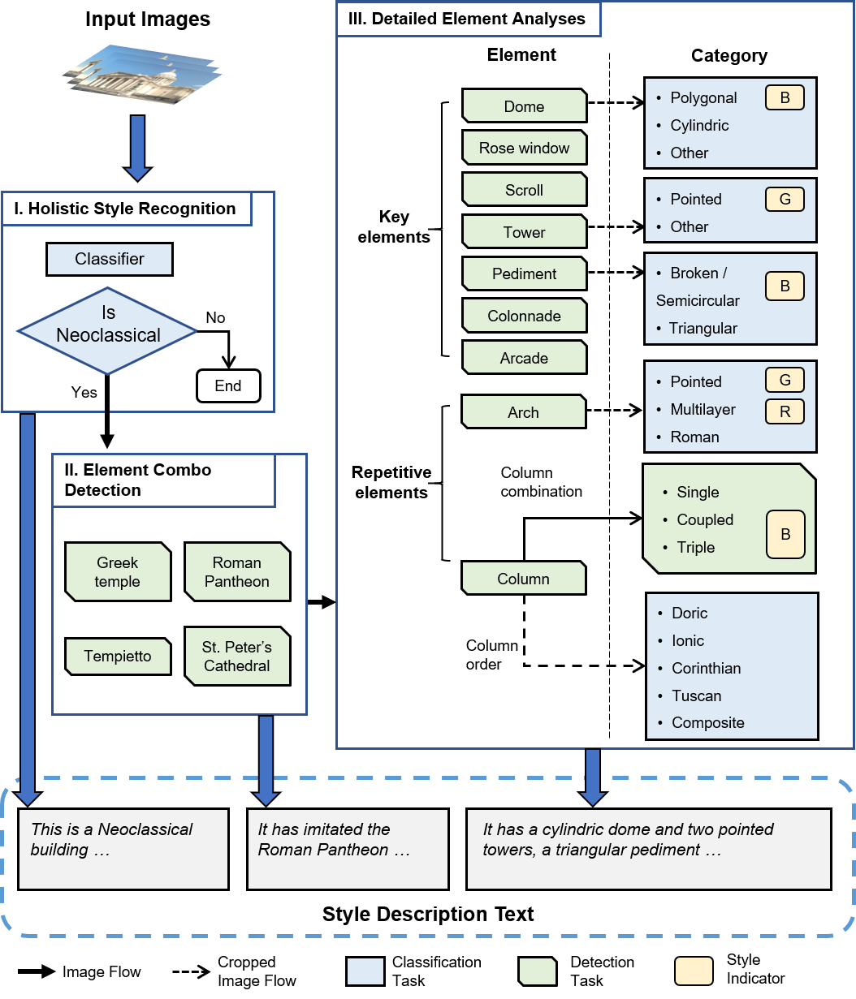
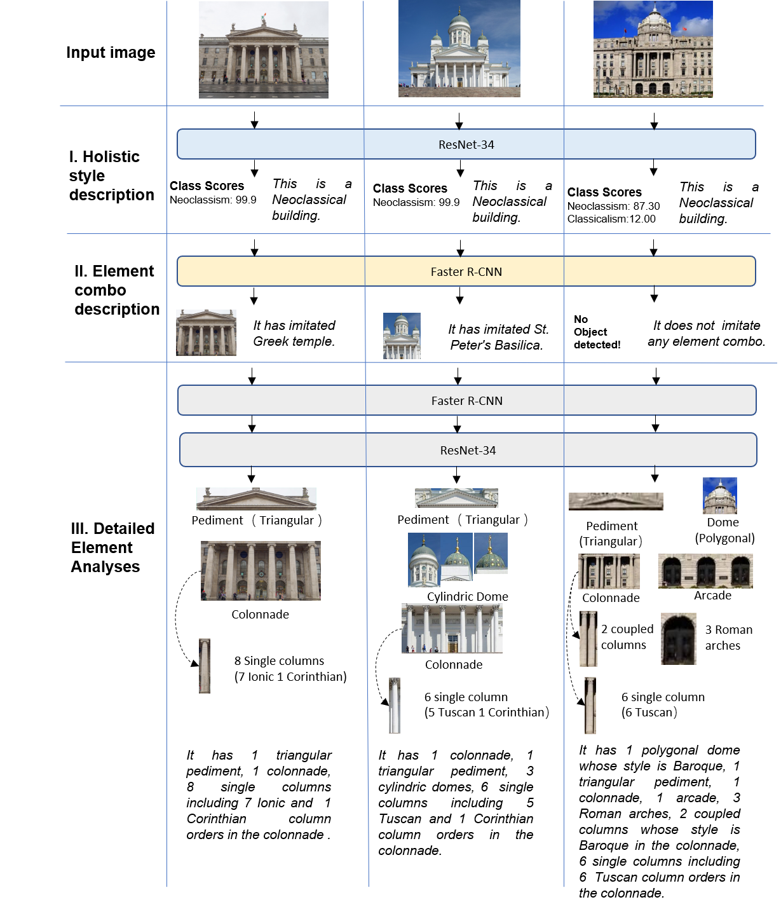
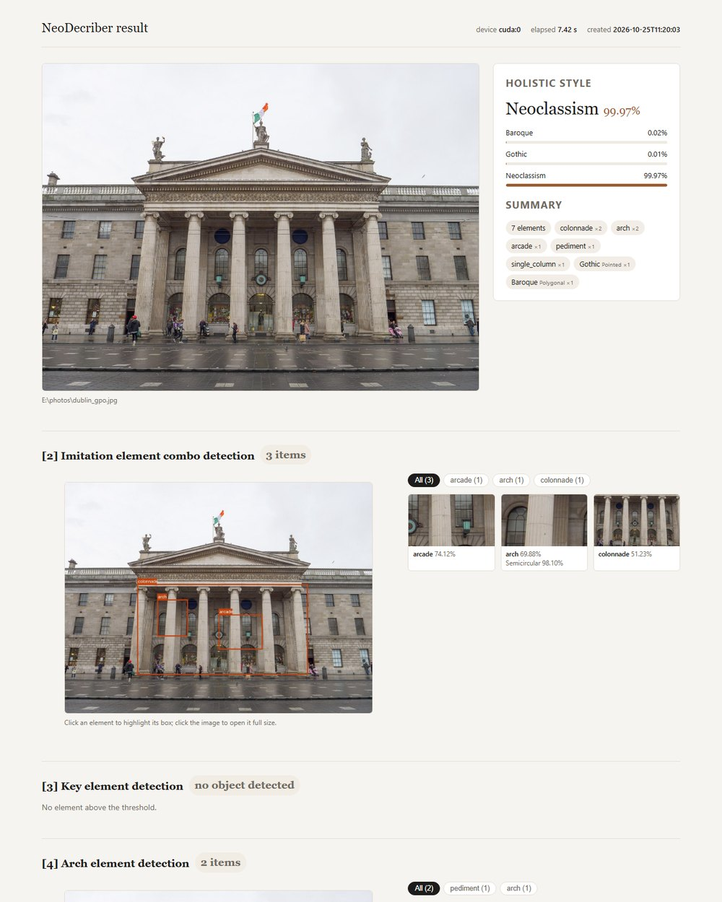

# NeoDecriber

Computer vision and rule-based cascaded model for describing neoclassical architecture. This is the
code release for the paper *NeoDescriber: Computer Vision and Rule-based Cascaded Model for
Neoclassical Architecture Description*.

Given a photo of a building, NeoDecriber first classifies its **holistic style**, then — when the
building is neoclassical — detects its **architectural elements**, and finally describes their
distribution, combination, and fine-grained style. The description is coarse-to-fine: one style
label for the whole façade, then a list of the elements that carry it.



*Fig. 1 — Framework and workflow. Rounded boxes indicate element styles: B for Baroque, G for
Gothic, R for Romanesque.*



*Fig. 2 — Descriptions of three monuments: General Post Office (Dublin), Helsinki Cathedral, and the
Shanghai Pudong Development Bank building.*

## Installation

Requires Python 3.8–3.12 (verified on 3.8).

```bash
pip install -r requirements.txt
```

`torch` and `torchvision` are installed from PyPI. For GPU inference, install the build matching
your CUDA version first (see <https://pytorch.org/get-started/locally/>), then run the command above
— pip keeps the versions you already have.

## Model weights

Download the trained weights from
[Google Drive](https://drive.google.com/file/d/1hW6u_YmdBM2acwddWmhJkQ98PHm4y5Ys/view?usp=sharing)
and unzip them next to `main.py`, so that the folder layout is:

```
source/
├── holistic_style/        class_indices.json   resNet34.pth
├── imitation/             my_source_data_class2num.json   resNetFpn-model.pth
├── key_element/           my_source_data_class2num.json   resNetFpn-model.pth
├── arch/                  my_source_data_class2num.json   resNetFpn-model.pth
├── column_combination/    my_source_data_class2num.json   resNetFpn-model.pth
├── single_column/         my_source_data_class2num.json   resNetFpn-model.pth
├── pediment/              class_indices.json   resNet34.pth
├── tower/                 class_indices.json   resNet34.pth
├── dome/                  class_indices.json   resNet34.pth
├── Arch_classification/   class_indices.json   resNet34.pth
└── column_order/          class_indices.json   resNet34.pth
```

`source/` is git-ignored because the weights are large. If you keep them elsewhere, pass
`--source-dir`.

## Usage

```bash
python main.py --img-path ./Dublin.jpg --output-dir ./result
```

The run reports per-stage timings on the console and writes everything to `--output-dir`.
Before the first real run you can check the setup without loading any model:

```bash
python main.py --img-path ./Dublin.jpg --output-dir ./result --dry-run
```

### Options

| Option | Description |
| --- | --- |
| `--img-path PATH` | Image to describe (required). |
| `--output-dir DIR` | Result folder, default `./result`. |
| `--device DEVICE` | `cuda:0` / `cpu`. Falls back to CPU when CUDA is unavailable. |
| `--source-dir DIR` | Folder holding the weights, default `<project>/source`. |
| `--overwrite` | Clear an existing output folder; without it existing files are kept. |
| `--dry-run` | Validate arguments and weights, print the plan, load no model. |
| `--line_thickness N` | Bounding-box line width, default 4. |
| `--font_size N` | Label font size, default 10. |

## Output

Everything lands in `--output-dir`:

```
result.txt    human-readable report
result.json   the same data as structured JSON
report.html   interactive report — open it in any browser
input.jpg     downscaled copy of the input image used by the report
report/*.jpg  downscaled annotated images used by the report
*.jpg         annotated image per detection stage
<stage>/*.jpg cropped element images
```



*`report.html`: the generated description, style probabilities, one card per stage, and the cropped
elements. Click an element to highlight its box on the annotated image; click the image to open it
full size.*

`result.txt` — style probabilities, one table per stage, a summary, and a generated description:

```
[1] Holistic style classification
    Neoclassism  99.98%
    probabilities : Baroque 0.02% | Classicalism 0.00% | Gothic 0.00% | Neoclassism 99.98% ...

[3] Key element detection   2 items (colonnade 1, pediment 1)
      #  label             score  style                     crop
      0  colonnade         99.4%  -                         key_element/colonnade_0.jpg
      1  pediment          99.1%  Triangular 97.3%          key_element/pediment_1.jpg

Summary
    style           : Neoclassism (99.98%)
    elements        : single_column 8, GreekTemple 1, colonnade 1, pediment 1
    implicit styles : -
    elapsed         : 18.89 s

Description
    This is a Neoclassical building. It has imitated Greek temple. It has 1 triangular
    pediment, 1 colonnade, and 8 single columns including 5 Ionic and 3 Corinthian column
    orders in the colonnade.
```

The description is generated by rules from the structured result (`describe.py`): one sentence for the
holistic style, one for the imitation source if the model recognised a temple prototype, and one that
lists the detected elements with their counts, inline element styles and column orders. Same input
always gives the same text — no model call, nothing to install.

`result.json` keeps the same information with numbers, boxes and file paths, for batch statistics
(one detection shown here):

```json
{
  "image": "D:\\data\\test.jpg",
  "description": "This is a Neoclassical building. It has imitated Greek temple. ...",
  "style": {"top": "Neoclassism", "prob": 0.9997, "is_neoclassism": true,
            "classes": [{"name": "Baroque", "prob": 0.0003}]},
  "stages": [
    {"task": 3, "title": "Arch element detection", "threshold": 0.5,
     "annotated_image": "arch_element.jpg",
     "detections": [
       {"label": "arch", "score": 0.51, "bbox": [120.0, 80.0, 260.0, 400.0],
        "crop": "arch_element/arch_0.jpg",
        "style": {"name": "Pointed", "prob": 0.98, "implicit": "Gothic"}}
     ]}
  ],
  "summary": {"total_detections": 1, "counts": {"arch": 1},
              "implicit_styles": [{"implicit": "Gothic", "class": "Pointed", "count": 1}]}
}
```

## Example output

`example_result/` is a complete run on `Dublin.jpg` (General Post Office, Dublin) with the released
weights — open `example_result/report.html` in a browser to see it:

```
example_result/
├── result.txt          report with the generated description
├── result.json         structured data
├── report.html         interactive page
├── input.jpg           input image used by the report
├── *.jpg               annotated image per detection stage
├── report/*.jpg        downscaled stage images used by the page
└── <stage>/*.jpg       cropped elements
```

It classified the building as Neoclassical (99.98%) with a colonnade, a triangular pediment and eight
single columns (five Ionic, three Corinthian) — the elements the GPO portico actually has.

## How it works

1. **Holistic style** — a ResNet34 classifies the whole image; the classes come from
   `source/holistic_style/class_indices.json` (Baroque / Gothic / Neoclassism for the released
   weights).
2. **Element detection** — only if the top class is Neoclassism, five ResNet50-FPN Faster R-CNN
   detectors run in sequence: imitation element combinations, key elements, arch elements, column
   combinations, single columns. Only the largest pediment survives, because a façade has one.
3. **Element style** — every detected element is cropped and passed to a task-specific ResNet34
   (`pediment`, `tower`, `dome`, column order, arch type). Some element styles imply a secondary
   style: `Pointed → Gothic`, `Broken/semicircular` and `Polygonal → Baroque`,
   `Multilayer → Romanesque`.

## Project layout

```
main.py            CLI, report formatting, result.json
utils.py           model loading/caching, style prediction, element detection
model.py           ResNet34 classifier and Faster R-CNN factory
draw_box_utils.py  bounding boxes, labels, element crops
backbone/          ResNet50-FPN backbone
network_files/     Faster R-CNN implementation
source/            model weights (not tracked)
```

## Citation

Qin, W., Chen, L., Zhang, B., Chen, W., Luo, H. *NeoDescriber: Computer Vision and Rule-based
Cascaded Model for Neoclassical Architecture Description.*

---

<p class=footer>
&copy; Copyright 2022 by <a href="http://ndc.hust.edu.cn">NDC at HUST</a></p>
